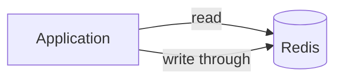

# Should the session cache move to Redis?

Date: 2026-10-13. Question: can the session cache move from process memory to Redis with no visible latency cost?

## Summary

- Yes. Redis adds 0.4 ms at the median on the local network.
- The cache survives a deploy, so users stay signed in.
- Cost: one more service to run.

## Decisions for you

| # | Decision | Recommended |
| - | -------- | ----------- |
| 1 | Run Redis as a managed service or on our own hosts | Managed |
| 2 | Keep the in-memory cache as a fallback | No |

## 1. Context

The cache holds 40 000 sessions at peak and loses all of them on each deploy.

### 1.1 Current cache

Each process keeps its own map, so a user who moves to another process signs in again.

## 2. Design

The application reads from Redis first and writes through on each change.

## 3. Measurements

Latency per request size, local network, 1000 requests each.

| KB | p50 | p99 |
| -- | --- | --- |
| 1 | 3 ms | 5 ms |
| 2 | 6 ms | 10 ms |
| 3 | 9 ms | 15 ms |
| 4 | 12 ms | 20 ms |
| 5 | 15 ms | 25 ms |
| 6 | 18 ms | 30 ms |
| 7 | 21 ms | 35 ms |
| 8 | 24 ms | 40 ms |
| 9 | 27 ms | 45 ms |
| 10 | 30 ms | 50 ms |
| 11 | 33 ms | 55 ms |
| 12 | 36 ms | 60 ms |
| 13 | 39 ms | 65 ms |

## 4. Risks

| Risk | Mitigation |
| ---- | ---------- |
| Redis outage | Sessions fall back to sign-in |
| Network split | Health check removes the node |

## Sources

1. Redis latency guide — https://redis.io/docs/latest/operate/oss_and_stack/management/optimization/latency/
2. Local benchmark, 2026-10-13, `redis-benchmark -q -n 1000`
